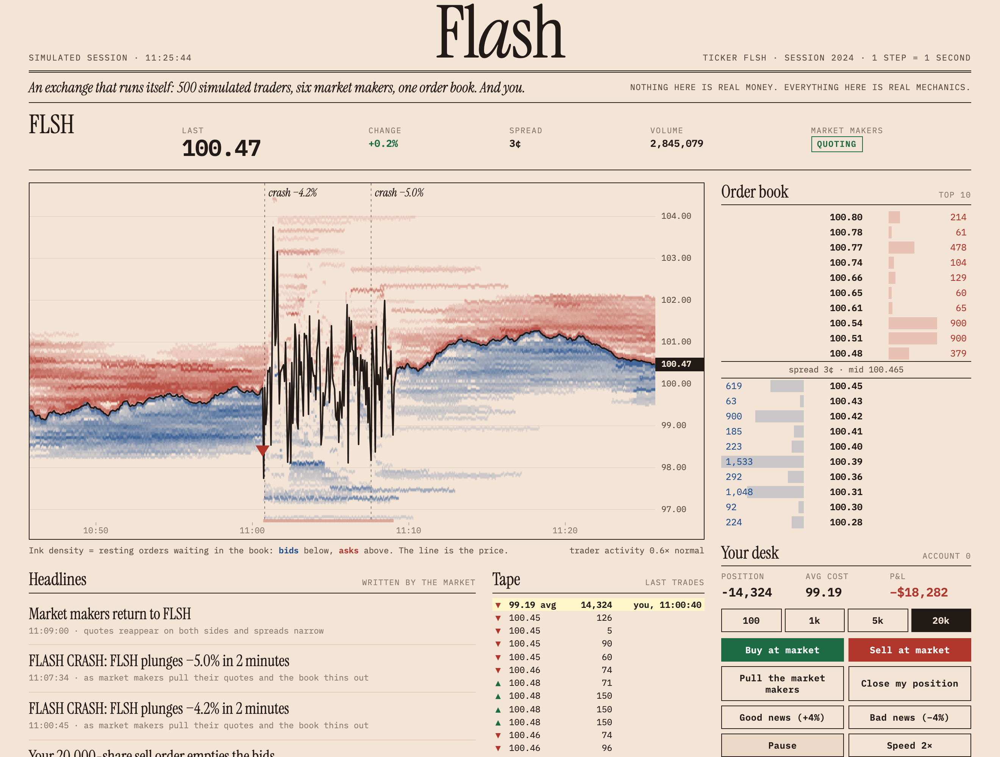

# Flash

**A living stock exchange: 500 simulated traders, six market makers, one order book, and you. Pull the market makers, dump 20,000 shares, and watch a flash crash happen.**



**[Open the exchange in your browser →](https://thewingthewong.github.io/flash/)** · no install, no sign-up

An exchange that runs itself. Buy and sell at market, dump 20,000 shares, pull the market makers out,
or hit it with good or bad news, then watch the order book react in a depth heatmap drawn as newspaper ink.
A live scoreboard checks whether the simulated tape has the statistical fingerprints of a real market,
and auto-written headlines explain crashes and squeezes as they happen.

Zero dependencies: plain HTML, CSS and ES modules, with no build step. Nothing here is real money.

## Run it

```sh
npm start            # http://127.0.0.1:8080
```

`?seed=123` opens a specific session. **Fast-forward 6 hours** fills the scoreboard;
**New random session** shows how much sessions vary. Keys: `b` buy, `s` sell, Space pause.

## How it works

- **Matching engine (`book.js`):** a limit order book with price-time priority (each price level
  is a FIFO queue), market, limit and immediate-or-cancel orders, cancellation, and a limit-up/limit-down
  price band. Every trade moves cash and shares between accounts, and a 20,000-order fuzz test checks
  both are conserved exactly and the book is never crossed.
- **Traders (`market.js`):** a Chiarella–Iori (2002) agent model. Each trader mixes value (pull
  toward a fundamental price that moves with bursts of news), trend (follow it, or bet against it; the
  population is balanced) and noise, then either rests a patient limit order or takes liquidity near the touch.
- **Market makers** quote post-only around a blend of the last price and their estimate of fair value,
  lean against inventory, and **pull out when volatility spikes**. Leaning toward fair value keeps calm
  trading efficient. Pulling out, together with self-exciting order arrival, is what turns a big sell
  order into a flash crash.
- **Is it a real market? (`stats.js`):** a live scoreboard measures the "stylized facts" of real
  returns from the session's one-minute returns: unpredictable returns, volatility clustering, fat tails
  that thin out at longer horizons, and a power-law tail (Hill estimator).
- **The desk (`app.js` + `index.html`):** depth heatmap with your trades and labelled crashes and squeezes,
  a top-10 ladder, the tape, your position and P&L, and headlines written from what the market just did.
  If an order empties one side of the book, the headline tells you how much actually filled.

## Honest results

Measured from the code in this repo (`npm test` checks the first two):

- **The flash-crash recipe works.** After 6 hours of trading, pulling the makers and dumping 20,000 shares
  dropped the price **0.7–2.7% at once** (median 1.3%) and **2.7–7.8% at the low a few minutes later**
  (median 5.0%), in all 30 sessions tested. With the makers in place the same dump does measurably less damage.
- **Stylized facts, across 24 sessions the model was not tuned on:** volatility clustering in 24/24,
  fat tails that thin out in 23/24, and a power-law tail exponent inside the real-market range (1.5–5,
  real ≈ 3) in 21/24. The scoreboard averages **3.2 of 4 ✓** per session.
- **The weakest fact is unpredictable one-minute returns.** In calm trading it holds (19/24 sessions,
  measured with crash minutes clipped, shown on the scoreboard as "calm"). But the raw number the ✓ is based
  on gets pushed past ±0.1 by a crash followed by a rebound, so the scoreboard often shows ✗ for it
  (it passes in 9/24 sessions). Expect three or four ✓ per session; *New random session* shows the variation.

## Test it

```sh
npm test             # engine, agents and statistics (node:test, no install needed)
npm install          # once, for Playwright
npx playwright install chromium
npm run test:e2e     # headless Chromium: trade, fast-forward, flash-crash recipe, chart, phone layout
```

The unit tests include a conservation fuzz test, known answers for every statistic (Gaussian kurtosis,
AR(1) autocorrelation, a Pareto tail with α = 3), the crash recipe across six sessions, and the stylized
facts across twelve. `node scripts/screenshot.mjs` regenerates the screenshot above.

## Limitations

- **One stock, one session at a time.** No other assets, no index, no news feed beyond the two buttons.
- **The model is a toy, on purpose.** Traders follow three simple motives; there are no hidden or iceberg
  orders, no short-selling limits, no fees, and your account has unlimited cash and credit.
- **While the makers are pulled, the price whipsaws.** The book gets so thin that the midpoint jumps
  between sparse quotes from second to second. That's the honest behaviour of this model, but real markets
  with no market makers would also see stub quotes and trading halts that Flash doesn't simulate.
- **Market orders only fill what the book holds.** With the makers pulled, a 20,000-share dump filled a median
  of about 11,000 shares across 30 sessions (5,000 to all 20,000) and the rest was cancelled; the headline says how much filled.
- **Sessions vary a lot.** Some are calm for hours, some have several crashes or squeezes. The scoreboard is
  measured on one session's returns, so any single session can miss a fact that holds across many.
- **1 step = 1 simulated second**, and the clock runs much faster than real time. Nothing here forecasts
  anything about real markets.

## License

[MIT](LICENSE). The bundled fonts are under the SIL Open Font License 1.1 (see [`fonts/README.md`](fonts/README.md)).
